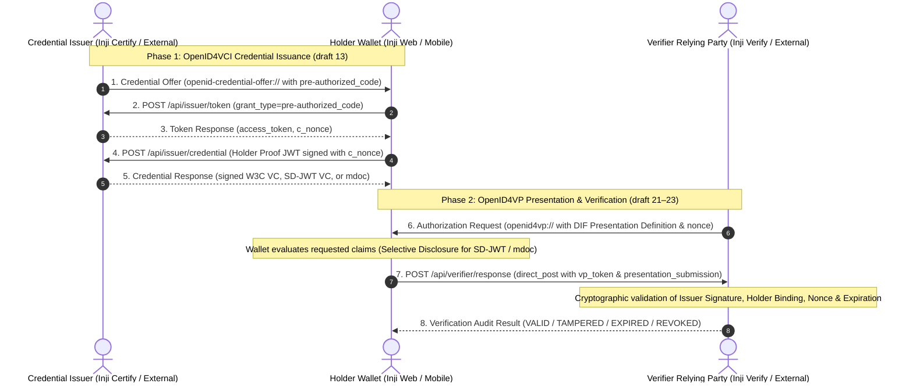

# Inji Interoperability Playground

> **A Unified Sandbox for Verifiable Credential Interoperability Testing across OpenID4VCI (draft 13), OpenID4VP (draft 21–23), W3C VC 1.1/2.0, IETF SD-JWT VC, and ISO/IEC 18013-5 mdoc.**

Developed for the **MOSIP Decode 2026** Challenge: *02 Inji | Build an Interoperability Playground for Verifiable Credentials*.

---

## 1. System Overview

The **Inji Interoperability Playground** provides an interactive, visual, and automated testing suite to verify the end-to-end credential lifecycle:
$$\text{Issuer (Inji Certify / External)} \xrightarrow{\text{OpenID4VCI}} \text{Holder Wallet (Inji Web / Mobile)} \xrightarrow{\text{OpenID4VP}} \text{Verifier (Inji Verify / External)}$$

### Core Capabilities:
- **3-Column Architecture Matrix:** Select any combination of Issuer, Wallet, and Verifier to run cross-ecosystem tests.
- **Three Core Credential Formats:**
  1. `ldp_vc`: **W3C VC 1.1 / 2.0 (JSON-LD)** with canonical JSON (RFC 8785) & Ed25519 / RSA detached JWS signatures.
  2. `vc+sd-jwt`: **IETF SD-JWT VC** (draft-ietf-oauth-sd-jwt-vc) with cryptographic salt generation, SHA-256 disclosure hashes, and Holder Key Binding JWT (KB-JWT).
  3. `mso_mdoc`: **ISO/IEC 18013-5 Mobile Driving License** with CBOR encoding, MobileSecurityObject (MSO) valueDigests tree, and DeviceSigned SessionTranscript authentication.
- **Live Visual Protocol Inspector:** Inspect raw HTTP requests, query params, headers, JSON payloads, and token decoding (JWS header/payload, SD-JWT disclosures, mDoc fields).
- **Interactive Animated Sequence Diagram:** Mermaid-powered live sequence showing message exchanges between Issuer, Wallet, Verifier, and Cryptographic Libraries.
- **Replay & Tamper Mode:** Deliberately corrupt payloads (corrupt signature, MITM claim modification, expired validity, replayed nonce, cross-site audience mismatch, revoked status) to evaluate Inji Verify's security assertions.
- **Automated CI-Style Interoperability Test Runner:** 12-test batch suite executing automated permutations across modules and negative paths.
- **Telemetry & Regression Matrix Dashboard:** Historical tracking, latency breakdown, pass/fail heatmap, and one-click Markdown report export.

---

## 2. System Architecture & Component Topology

```mermaid
graph TD
    classDef client fill:#18181b,stroke:#3f3f46,stroke-width:1px,color:#f4f4f5;
    classDef bff fill:#09090b,stroke:#52525b,stroke-width:1px,color:#f4f4f5;
    classDef module fill:#18181b,stroke:#71717a,stroke-width:1px,color:#f4f4f5;
    classDef protocol fill:#27272a,stroke:#3f3f46,stroke-width:1px,color:#e4e4e7;

    subgraph ClientWorkspace ["1. Client Workspace & UI (React 18 + Vite + Tailwind CSS)"]
        UI["Playground Workspace View"]:::client
        ThreeCol["3-Column Selector<br/>(Issuer ➔ Wallet ➔ Verifier)"]:::client
        FormatPicker["Format & Schema Picker<br/>(W3C VC / SD-JWT / mdoc)"]:::client
        WalletView["Inji Wallet Keystore Card<br/>(Selective Disclosure Controls)"]:::client
        Inspector["Protocol Inspector Panel<br/>(Raw HTTP, Payloads & Decoders)"]:::client
        SequenceDiag["Sequence Timeline<br/>(Live Exchange Visualizer)"]:::client
        TamperControl["Replay & Tamper Injector<br/>(Negative-Path Testing)"]:::client
        MatrixUI["Matrix Dashboard<br/>(Telemetry & Audit Grid)"]:::client
    end

    subgraph Orchestrator ["2. Playground BFF & Protocol Orchestration Engine (Node.js + Express)"]
        API["REST & WebSocket API Gateway (/api, /ws)"]:::bff

        subgraph CoreProtocols ["Standardized Protocol Implementations"]
            VCI_Engine["OpenID4VCI (draft 13)<br/>• /.well-known/openid-credential-issuer<br/>• Credential Offer Handler<br/>• Token Endpoint (Pre-Auth Code)<br/>• Proof of Possession (c_nonce)"]:::protocol
            VP_Engine["OpenID4VP (draft 21–23)<br/>• Presentation Definition (DIF PEX 2.0)<br/>• Cross-Device QR & Deep Link<br/>• Direct_Post Submission Handler<br/>• Verification & Revocation Pipeline"]:::protocol
        end

        subgraph Cryptography ["Cryptographic Verification Subsystems"]
            KeyStore["Key Infrastructure<br/>(Ed25519 did:key, RSA did:jwk, ES256)"]:::bff
            W3C_Engine["W3C VC 1.1/2.0 Engine<br/>(JCS RFC 8785, Ed25519Signature2020)"]:::bff
            SDJWT_Engine["IETF SD-JWT VC Engine<br/>(Salted Disclosures, SHA-256, KB-JWT)"]:::bff
            MDoc_Engine["ISO/IEC 18013-5 mdoc Engine<br/>(CBOR Namespaces, MSO Digests)"]:::bff
        end

        subgraph TestingEngine ["Diagnostics, Matrix & Telemetry"]
            TamperEngine["Mutation Engine<br/>(Signature, Claim, Nonce, Aud, Expiry)"]:::bff
            MatrixStore["Matrix Store & Telemetry<br/>(Run History, Stats, Markdown Export)"]:::bff
            SuiteRunner["Automated CI Suite Runner<br/>(12-Permutation Test Matrix)"]:::bff
        end
    end

    subgraph EcosystemMatrix ["3. Tested Ecosystem Modules"]
        subgraph Issuers ["Credential Issuers (OpenID4VCI)"]
            I_Inji["Inji Certify (MOSIP Core)"]:::module
            I_Walt["Walt.id Reference Issuer"]:::module
            I_Gen["Generic OID4VCI Mock"]:::module
        end

        subgraph Wallets ["Holder Wallets (Storage & VP)"]
            W_Web["Inji Web (Browser Wallet)"]:::module
            W_Mob["Inji Mobile (Mimoto / QR Bridge)"]:::module
            W_Gen["Generic Standards Wallet"]:::module
        end

        subgraph Verifiers ["Verifier Relying Parties (OpenID4VP)"]
            V_Inji["Inji Verify (MOSIP Core / SDK)"]:::module
            V_Sph["Sphereon / DIF Verifier"]:::module
            V_Gen["Generic OpenID4VP RP"]:::module
        end
    end

    UI --> API
    ThreeCol --> API
    FormatPicker --> API
    WalletView --> API
    TamperControl --> TamperEngine

    API --> VCI_Engine
    API --> VP_Engine
    API --> SuiteRunner

    VCI_Engine --> Cryptography
    VP_Engine --> Cryptography
    VCI_Engine --> TamperEngine
    VP_Engine --> TamperEngine

    VCI_Engine <--> Issuers
    VCI_Engine <--> Wallets
    VP_Engine <--> Wallets
    VP_Engine <--> Verifiers

    SuiteRunner --> MatrixStore
    MatrixStore --> MatrixUI
    VCI_Engine -.-> Inspector
    VP_Engine -.-> Inspector
    VCI_Engine -.-> SequenceDiag
    VP_Engine -.-> SequenceDiag
```



### Module Implementations:
- **Issuers:**
  - `inji-certify`: MOSIP Inji Certify protocol engine supporting pre-authorized code flows, Ed25519Signature2020, and mock MOSIP ID / eSignet schemas.
  - `waltid-issuer`: External Walt.id reference issuer with RS256/ES256 profiles.
  - `generic-oid4vci`: Pure OpenID4VCI draft 13 mock endpoint.
- **Wallets:**
  - `inji-web`: Browser keystore, selective disclosure claim toggles, and VP generation.
  - `inji-mobile`: Mobile bridge with QR presentation, deep-link triggers, and PixelPass compression emulation.
  - `generic-wallet`: External standards-compliant wallet mock.
- **Verifiers:**
  - `inji-verify`: MOSIP Inji Verify core service with strict DIF PEX 2.0 schema validation, cryptographic proof validation, temporal checks, and status list revocation checks.
  - `sphereon-verifier`: DIF/Sphereon reference relying party.
  - `generic-oid4vp`: Configurable OpenID4VP relying party.

---

## 3. Protocol Exchange Breakdown



### A. OpenID4VCI (draft 13) Issuance Flow
1. **Issuer Metadata Discovery:** `GET /.well-known/openid-credential-issuer` returns endpoints and `credentials_supported` array.
2. **Credential Offer:** Issuer emits `openid-credential-offer://` containing `pre-authorized_code`.
3. **OAuth 2.0 Token Exchange:** Wallet sends `POST /api/issuer/token` with `pre-authorized_code`; Issuer returns `access_token` and `c_nonce`.
4. **Holder Proof of Possession:** Wallet generates a JWS signed with its device key binding to `c_nonce` and issuer `aud`.
5. **Credential Issuance:** Wallet sends `POST /api/issuer/credential`; Issuer cryptographically signs and returns the credential.

### B. OpenID4VP (draft 21–23) Presentation & Verification Flow
1. **Authorization Request:** Verifier generates request with `presentation_definition` (DIF PEX 2.0), `nonce`, `client_id`, and `response_uri`.
2. **Cross-Device / Same-Device Presentation:** Displayed via QR code (`openid4vp://...`) and deep-link.
3. **Presentation Submission:** Wallet filters disclosed claims, binds holder proof to verifier `nonce` and `client_id`, and sends `POST /api/verifier/response` (`direct_post`).
4. **Inji Verify Pipeline:**
   - Validates descriptor mapping against Presentation Definition.
   - Verifies holder proof-of-possession signature.
   - Verifies issuer cryptographic signature over canonical document / MSO / SD-JWT.
   - Evaluates validity timestamps (`nbf`, `exp`, `validUntil`).
   - Queries revocation status list.
   - Emits structured `VerificationResult` (`VALID`, `INVALID`, `VALID_BUT_EXPIRED`, etc.).

---

## 4. Getting Started

### Prerequisites:
- Node.js 18+ (or use the packaged `.tools/node` runtime included in this workspace)
- Docker & Docker Compose (optional for containerized deployment)

### Option 1: Quick Local Setup (Development Mode)

#### 1. Start the Backend BFF:
```bash
cd backend
npm install
npm run build
npm start
```
*Backend runs at `http://localhost:4000` (WebSocket at `ws://localhost:4000/ws`).*

#### 2. Start the Frontend UI:
```bash
cd frontend
npm install
npm run dev
```
*Frontend runs at `http://localhost:5173` (with proxy to backend).*

---

### Option 2: One-Command Docker Compose

```bash
docker-compose up --build
```
*Open `http://localhost:3000` in your browser.*

---

## 5. Running the Automated Test Matrix Suite

The project includes 15 automated unit, cryptographic, and integration tests covering the entire matrix:
```bash
cd backend
npm test
```

### Test Suite Coverage:
- `tests/crypto.test.ts`:
  - Ed25519 & RSA key pair generation & `did:key` resolution
  - W3C VC canonical signing (JCS) and detached JWS verification
  - IETF SD-JWT VC salted disclosure calculation, selective disclosure, KB-JWT binding, and verification
  - ISO 18013-5 mdoc CBOR encoding, MSO digest tree, and DeviceSigned SessionTranscript verification
- `tests/protocols.test.ts`:
  - Core Inji Stack end-to-end (Inji Certify -> Inji Web -> Inji Verify)
  - Cross-ecosystem flows (Walt.id -> Inji Web -> Inji Verify)
  - 12-test automated batch test runner
- `tests/tamper.test.ts`:
  - Corrupted signature rejection (`TAMPERED_SIGNATURE`)
  - MITM claim modification rejection (`TAMPERED_SIGNATURE`)
  - Expired credential rejection (`VALID_BUT_EXPIRED`)
  - Replayed nonce rejection (`INVALID_NONCE`)
  - Cross-site audience mismatch rejection (`MISMATCHED_AUDIENCE`)
  - Revoked credential rejection (`REVOKED`)

---

## 6. Real Interoperability Gaps Discovered

See [`INTEROP_GAP_REPORT.md`](file:///c:/Users/Hp/Downloads/MOSIP_DECODE_2026/INTEROP_GAP_REPORT.md) for the complete engineering write-up and GitHub issue templates:
1. **QR Optical Density Failures in Offline W3C VC:** Payloads > 2.2 KB exceed mobile camera focus capabilities in field environments. (Recommended fix: Chunked animated QR streaming via PixelPass / BC-UR).
2. **OpenID4VP `direct_post.jwt` Mandate:** EUDI / eIDAS relying parties require JWE encrypted responses, while Inji Verify historically expected plaintext `direct_post`.
3. **DID Method Diversity:** Government PKI and mobile platform keystores require `did:web` and NIST P-256 (`ES256`), whereas Inji defaults to `did:key:z...` (Ed25519).
4. **DIF PEX Path Mismatch:** W3C-style `$.credentialSubject.uin` queries fail on flat SD-JWT claims (`$.uin`).

---

## 7. License & Credits

Built for the **MOSIP Decode 2026 Challenge**. Open-source under the MIT License.
