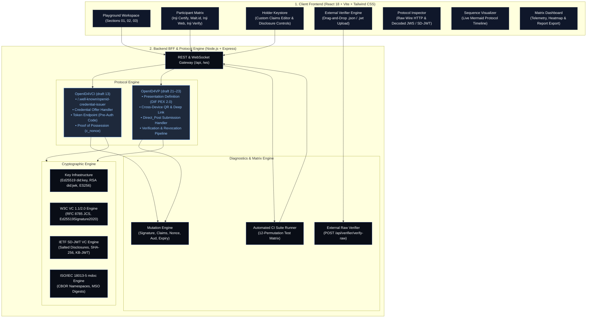
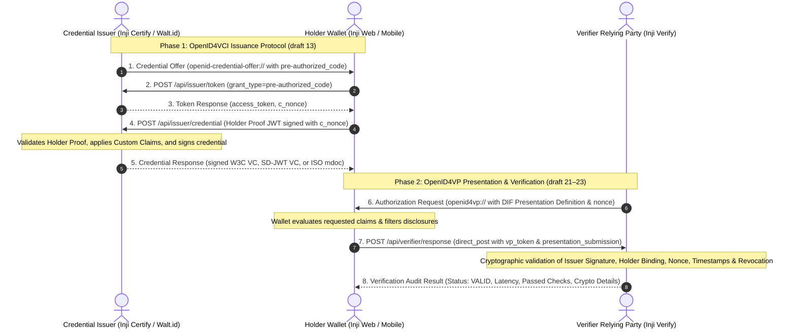

# Inji Interoperability Playground

> **A Multi-Standard Verification & Diagnostic Testbed for Verifiable Credentials across OpenID4VCI (draft 13), OpenID4VP (draft 21–23), W3C VC 1.1/2.0, IETF SD-JWT VC, and ISO/IEC 18013-5 mdoc.**

---

### Challenge Submission Metadata

| Attribute | Details |
| :--- | :--- |
| **Hackathon** | **MOSIP Decode 2026** |
| **Challenge** | **Challenge 02: Inji \| Build an Interoperability Playground for Verifiable Credentials** |
| **Team Name** | **!Paradox!** |
| **Team Members** | **Jay Gheewala** ([jaygheewala06@gmail.com](mailto:jaygheewala06@gmail.com))<br/>**Harshil Agarwal** ([harshilindia011@gmail.com](mailto:harshilindia011@gmail.com)) |
| **Repository** | [github.com/Jay1q2w/Interoperability-Playground-for-Verifiable-Credentials](https://github.com/Jay1q2w/Interoperability-Playground-for-Verifiable-Credentials.git) |
| **Deployment** | Docker Compose (`docker-compose up --build`), Node.js 18+ (Express BFF + React 18 / Vite / Tailwind) |

---
## Video Demo
https://github.com/user-attachments/assets/f5fbcf7c-688f-43c6-ab29-2928b77de8bf

## 1. Executive Summary

Interoperability in decentralized identity cannot be validated through mock mocks or static presentations alone. The **Inji Interoperability Playground** built by **Team !Paradox!** provides a cryptographic, protocol-level workbench that simulates and evaluates genuine cross-ecosystem exchanges between Credential Issuers, Holder Wallets, and Verifier Relying Parties.

```
       Phase 1: OpenID4VCI (draft 13)                 Phase 2: OpenID4VP (draft 21-23)
[ Credential Issuer ] ───────────────▶ [ Holder Wallet ] ───────────────▶ [ Verifier RP ]
 (Inji Certify / Walt.id)               (Inji Web / Mobile)               (Inji Verify / Core)
```

The system verifies end-to-end credential issuance and presentation across **three foundational credential standards**, provides **real user/judge input capabilities** via an in-keystore claims editor and an external credential upload engine, executes an **automated 12-permutation test matrix**, and audits real security boundaries through a dedicated **replay and tamper attack suite**.

---

## 2. Core Capabilities & Architecture

### A. Three Standard Credential Formats (Cryptographically Implemented)
1. **W3C VC 1.1 / 2.0 (`ldp_vc`):**
   - Implements JSON Canonicalization Scheme (**RFC 8785 / JCS**).
   - Generates and verifies **Ed25519Signature2020** detached JWS signatures over canonical payloads.
   - Wraps credentials in W3C Verifiable Presentations with holder proof-of-possession.
2. **IETF SD-JWT VC (`vc+sd-jwt`):**
   - Implements `draft-ietf-oauth-sd-jwt-vc` specification.
   - Generates cryptographically secure 128-bit random salts for every disclosure claim.
   - Calculates SHA-256 base64url digests for `_sd` arrays.
   - Issues and validates Holder Key Binding JWTs (**KB-JWT**) with `nonce` and `aud` binding.
3. **ISO/IEC 18013-5 mdoc (`mso_mdoc`):**
   - Mobile Driving License (mDL) profile using CBOR serialization.
   - Builds hierarchical `MobileSecurityObject` (MSO) with `valueDigests` hash trees.
   - Implements `DeviceSigned` authentication verified against `SessionTranscript` structure.

---

### B. Real Input & Custom Data Testing
To ensure the playground is not merely a static showcase, it provides two direct developer/judge input workflows:
1. **Custom Subject Identity Claims Editor:**
   - Evaluators can directly edit subject identity attributes (names, national IDs, birthdates) or create arbitrary custom attributes (e.g., `bloodGroup`, `clearanceLevel`) directly inside the Wallet keystore before issuance.
   - **Inji Certify** signs these exact custom attributes in real time, and **Inji Verify** validates the resulting presentation.
2. **Direct External Credential Verification Engine (Upload & Paste):**
   - Evaluators can drag-and-drop or paste third-party `.json` files (W3C VC / VP), `.jwt` files (IETF SD-JWT strings), or raw tokens directly into Inji Verify via `POST /api/verifier/verify-raw`.
   - Inji Verify parses the external payload, resolves the issuer's public key (DID / JWK), validates cryptographic signatures, checks temporal validity, and returns a granular audit certificate.

---

### C. 3-Section Editorial UI Architecture
The playground UI is structured into three numbered, sequential engineering sections:

```
┌─────────────────────────────────────────────────────────────────────────────┐
│ SECTION 01: TEST MATRIX & PROTOCOL SPECIFICATION                            │
│ ├─ Standard Benchmarks (MOSIP ID, SD-JWT, ISO mdoc, Walt.id Interop, Tamper)│
│ ├─ Active Pipeline Visualizer (Issuer ──▶ Wallet ──▶ Verifier)              │
│ └─ Detailed Configuration (3-Column Selector, Format Picker, Attack Inject) │
├─────────────────────────────────────────────────────────────────────────────┤
│ SECTION 02: HOLDER WALLET & CREDENTIAL DATA KEYSTORE                        │
│ ├─ Security Document Biometric Card Visual                                  │
│ ├─ Subject Claims Editor (Live Attribute Customization & Pre-Issuance Input)│
│ ├─ Selective Disclosure Toggles (SD-JWT / mdoc claim privacy masking)       │
│ └─ Cross-Device QR Presentation (OpenID4VP scan payload & Universal Link)   │
├─────────────────────────────────────────────────────────────────────────────┤
│ SECTION 03: PROTOCOL EXECUTION & CRYPTOGRAPHIC VERIFICATION                 │
│ ├─ Verification Verdict Banner (Status, Latency, Passed Checks, Keys)      │
│ ├─ Interactive Sequence Diagram (Mermaid-rendered live message exchanges)   │
│ ├─ Wire Protocol Inspector (Raw HTTP requests/responses, token decoders)    │
│ └─ External Credential Verification Engine (Drag & drop upload / paste)     │
└─────────────────────────────────────────────────────────────────────────────┘
```

---

### D. Negative-Path & Replay Security Testing
The playground incorporates an adversarial mutation engine to test Inji Verify against 6 deliberate security attacks:
- **`TAMPERED_SIGNATURE`:** Corrupts the cryptographic signature bytes; Inji Verify detects signature mismatch and rejects.
- **`TAMPERED_CLAIMS`:** Simulates Man-in-the-Middle (MITM) attribute alteration after signing; cryptographic proof fails.
- **`VALID_BUT_EXPIRED`:** Synthesizes expired `validUntil` / `exp` timestamps; Inji Verify enforces temporal rejection.
- **`INVALID_NONCE`:** Replays a stale challenge nonce; Inji Verify detects replay and aborts.
- **`MISMATCHED_AUDIENCE`:** Points audience (`aud`) to an untrusted relying party; Inji Verify rejects domain mismatch.
- **`REVOKED_STATUS`:** Issues credentials marked revoked in the Revocation Status List; Inji Verify confirms revocation status.

---

### E. Telemetry & Automated CI Test Matrix Runner
- **Automated Matrix Runner:** Automatically executes a 12-permutation matrix covering all combinations of Issuers, Wallets, Verifiers, Credential Formats, and Tamper scenarios.
- **Matrix Dashboard:** Real-time pass/fail heatmap, latency distribution, filterable execution history, and one-click export to Markdown (`INTEROP_MATRIX_RESULTS.md`).
- **Telemetry Storage:** Thread-safe file-backed persistence storing detailed step timings, payloads, and cryptographic verification outputs.

---

## 3. System Architecture Diagram



---

## 4. End-to-End Protocol Flow



---

## 5. Getting Started & Deployment

### Option 1: Docker Compose (Recommended)

Run the entire stack in isolated Docker containers:

```bash
docker-compose up --build
```

- **Frontend UI:** Access at `http://localhost:3000`
- **Backend API & WebSocket:** Accessible at `http://localhost:4000` (Healthcheck: `http://localhost:4000/health`)

---

### Option 2: Local Development Setup

#### Prerequisites
- Node.js 18+ (or use the packaged runtime in `.tools/node`)
- npm 9+

#### 1. Start the Backend BFF:
```bash
cd backend
npm install
npm run build
npm start
```
*Backend listens on `http://localhost:4000` (WebSocket at `ws://localhost:4000/ws`).*

#### 2. Start the Frontend UI:
```bash
cd frontend
npm install
npm run dev
```
*Frontend runs on `http://localhost:5173` (proxies `/api` and `/ws` to `localhost:4000`).*

---

## 6. Automated Testing & Verification

The repository contains 15 automated Jest tests covering unit cryptography, protocol flows, and negative-path mutations:

```bash
cd backend
npm test
```

### Verified Test Suite Breakdown (15/15 Passing):
```
PASS tests/crypto.test.ts
  Cryptographic Engines & Credential Formats
    Key Infrastructure
      ✓ generates valid Ed25519 key pair with did:key
      ✓ generates valid RSA key pair with did:jwk
    W3C Verifiable Credentials 1.1 / 2.0 (ldp_vc)
      ✓ creates, wraps, and verifies valid W3C VC and VP
    IETF SD-JWT VC (vc+sd-jwt)
      ✓ issues, selectively discloses, and verifies SD-JWT with KB-JWT
    ISO/IEC 18013-5 mdoc / mDL (mso_mdoc)
      ✓ issues and verifies mDoc DeviceResponse with MSO digest tree

PASS tests/protocols.test.ts
  OpenID4VCI & OpenID4VP Protocol Flows
    ✓ runs Core Inji Stack end-to-end with W3C VC JSON-LD
    ✓ runs Core Inji Stack end-to-end with SD-JWT VC
    ✓ runs Cross-Ecosystem interop: Walt.id Issuer -> Inji Web -> Inji Verify
    ✓ runs automated test matrix suite (12 permutations)

PASS tests/tamper.test.ts
  Replay & Tamper Negative-Path Tests
    ✓ rejects corrupted signature with TAMPERED_SIGNATURE
    ✓ rejects tampered claim (MITM attribute modification)
    ✓ rejects expired credential with VALID_BUT_EXPIRED
    ✓ rejects replayed nonce with INVALID_NONCE
    ✓ rejects audience mismatch with MISMATCHED_AUDIENCE
    ✓ rejects revoked credential with REVOKED
```

---

## 7. Interoperability Gaps & MOSIP Contributions

A critical deliverable for Challenge 02 is identifying concrete gaps in the current Inji implementation when interacting with external standards. Detailed technical analyses and GitHub issue templates are documented in [`INTEROP_GAP_REPORT.md`](file:///c:/Users/Hp/Downloads/MOSIP_DECODE_2026/INTEROP_GAP_REPORT.md):

1. **GAP-01: Optical QR Density Limits in Offline W3C VC Presentations (`mosip/inji-wallet`):**
   - *Problem:* Full W3C JSON-LD presentations exceed 2.4 KB, surpassing optical scan capacities of mid-range mobile cameras.
   - *Recommendation:* Integrate chunked animated QR code streaming (PixelPass / BC-UR) and standardize on IETF SD-JWT for offline QR codes.
2. **GAP-02: OpenID4VP `direct_post.jwt` with JWE Encryption (`mosip/inji-verify`):**
   - *Problem:* Cross-border European Relying Parties (EUDI / eIDAS 2.0) mandate encrypted `direct_post.jwt` responses.
   - *Recommendation:* Implement ECDH-ES JWE response decryption pipeline in Inji Verify.
3. **GAP-03: DID Method and Public Key Algorithm Diversity (`mosip/inji-certify`):**
   - *Problem:* Inji primarily targets `did:key:z6Mk...` (Ed25519), causing incompatibilities with enterprise `did:web` and hardware keystores requiring NIST P-256 (`ES256`).
   - *Recommendation:* Implement DID resolution abstraction layer supporting `did:web` and `did:jwk`.
4. **GAP-04: DIF Presentation Exchange JSONPath Evaluation Divergence (`mosip/inji-verify`):**
   - *Problem:* Standard JSONPath filters designed for nested W3C schemas (`$.credentialSubject.uin`) fail on flat SD-JWT payload structures.
   - *Recommendation:* Support format-aware JSONPath normalizers in the DIF PEX engine.

---

## 8. Repository Structure

```
MOSIP_DECODE_2026/
├── backend/
│   ├── src/
│   │   ├── crypto/                # Cryptographic signing & verification engines
│   │   │   ├── keys.ts            # Key infrastructure (Ed25519, RSA, ES256)
│   │   │   ├── w3c.ts             # W3C VC 1.1/2.0 canonical JCS & JWS engine
│   │   │   ├── sdjwt.ts           # IETF SD-JWT VC salted disclosure engine
│   │   │   └── mdoc.ts            # ISO 18013-5 mdoc CBOR & MSO engine
│   │   ├── protocols/             # OpenID4VC protocol implementations
│   │   │   ├── openid4vci.ts      # OpenID4VCI draft 13 issuance handlers
│   │   │   └── openid4vp.ts       # OpenID4VP draft 21-23 presentation & verifier
│   │   ├── routes/
│   │   │   └── api.ts             # REST API gateway endpoints (/api/*)
│   │   ├── services/
│   │   │   ├── suiteRunner.ts     # Automated CI test matrix engine
│   │   │   ├── tamperEngine.ts    # Adversarial mutation engine
│   │   │   └── matrixStore.ts     # Telemetry & persistence store
│   │   └── server.ts              # Express BFF entry point with WebSocket
│   ├── tests/                     # 15 automated unit & integration tests
│   ├── Dockerfile                 # Node 18 Alpine production container
│   └── package.json
├── frontend/
│   ├── src/
│   │   ├── components/            # UI components (Sectional layout)
│   │   │   ├── Header.tsx         # Header navigation & global run action
│   │   │   ├── WalletCard.tsx     # Section 02: Biometric card & claims editor
│   │   │   ├── ExternalVerifierTester.tsx # Drag-and-drop .json/.jwt verifier
│   │   │   ├── ThreeColumnSelector.tsx    # Participant module picker
│   │   │   ├── FormatProfileSelector.tsx  # Format & schema selector
│   │   │   ├── TamperSelector.tsx         # Negative-path attack controls
│   │   │   ├── SequenceDiagram.tsx        # Interactive Mermaid sequence visualizer
│   │   │   ├── ProtocolInspector.tsx      # Wire HTTP & payload token decoders
│   │   │   └── VerificationResultModal.tsx# Cryptographic audit certificate modal
│   │   ├── pages/
│   │   │   ├── PlaygroundPage.tsx # Main 3-Section workspace
│   │   │   ├── MatrixDashboardPage.tsx # Telemetry, heatmap & report export
│   │   │   └── GapsReportPage.tsx # Interoperability gap viewer & templates
│   │   └── services/api.ts        # Frontend REST & WebSocket client
│   ├── Dockerfile                 # Multi-stage Nginx container
│   └── package.json
├── docker-compose.yml             # Unified container orchestration
├── API_DOCUMENTATION.md          # Comprehensive technical API reference & schemas
├── INTEROP_GAP_REPORT.md          # Full architectural gap analysis & GitHub issues
├── INTEROP_MATRIX_RESULTS.md      # Auto-generated 12-test matrix telemetry export
└── README.md                      # Project documentation (Team !Paradox!)
```

---

## 9. Team & Submission Credits

- **Team Name:** **!Paradox!**
- **Team Members:**
  - **Jay Gheewala** ([jaygheewala06@gmail.com](mailto:jaygheewala06@gmail.com))
  - **Harshil Agarwal** ([harshilindia011@gmail.com](mailto:harshilindia011@gmail.com))
- **Event:** MOSIP Decode 2026 Hackathon
- **License:** Open-source under the [MIT License](LICENSE).
